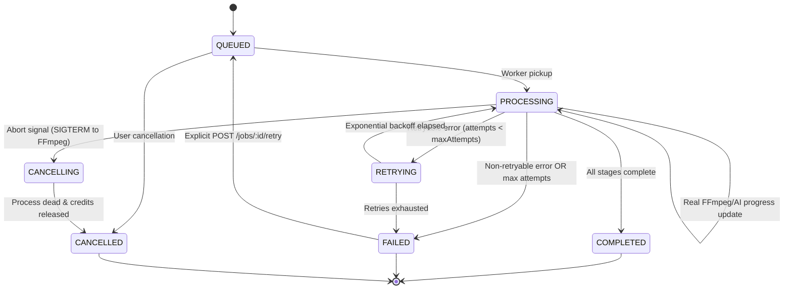

# FrameForge: Production-Grade Media Processing & Export Backend

[](https://www.typescriptlang.org/)
[](https://nodejs.org/)
[](https://www.postgresql.org/)
[](https://redis.io/)
[](https://bullmq.io/)
[](https://ffmpeg.org/)
[]()

> A robust, fault-tolerant backend system for cloud video editing platforms (inspired by Cardboard's high-throughput video processing infrastructure). Built around asynchronous job processing, strict state machine governance, financial-grade credit reservation, worker crash recovery, programmatic FFmpeg transcoding, and honest real-time progress streaming.

---

## 1. Architectural Overview

FrameForge is architected as a **modular monolith** with dedicated, decoupled BullMQ worker processes. HTTP request handlers never execute heavy media or AI operations synchronously—instead, they validate inputs, execute database-backed credit reservations, and immediately enqueue background jobs.

```mermaid
graph TD
    Client[Web UI / REST Client] -->|HTTP REST API| API[Express API Server]
    Client <-->|WebSockets (Socket.IO)| API
    
    API -->|Prisma ORM (Row Locking)| DB[(PostgreSQL)]
    API -->|Enqueue & Idempotency Locks| Redis[(Redis 7)]
    
    subgraph BullMQ Queues
        Q_Proxy[Proxy Queue]
        Q_Transcode[Transcode Queue]
        Q_AI[AI Analysis Queue]
        Q_Export[Export Queue]
    end
    
    Redis --> Q_Proxy
    Redis --> Q_Transcode
    Redis --> Q_AI
    Redis --> Q_Export
    
    subgraph Distributed Workers
        W_Proxy[Proxy Worker]
        W_Transcode[Transcode Worker]
        W_AI[AI Analysis Worker]
        W_Export[Export Worker]
    end
    
    Q_Proxy --> W_Proxy
    Q_Transcode --> W_Transcode
    Q_AI --> W_AI
    Q_Export --> W_Export
    
    W_Proxy -->|FFmpeg libx264| Storage[(Storage Volume)]
    W_Transcode -->|FFmpeg 1080p Normalizer| Storage
    W_Export -->|Parallel Filters & Compositing| Storage
    W_AI -->|Pluggable AI Provider| Storage
    
    Workers -->|Progress, Heartbeats & Audit Events| Redis
    Redis -->|Pub/Sub Event Bus| API
    API -->|job.progress / job.status_change| Client
```

---

## 2. Core Engineering Capabilities

### A. State Machine Invariants
Jobs follow a strictly enforced finite state machine (`JobStateMachine`). Invalid transitions (such as transitioning from `COMPLETED` back to `PROCESSING`, or modifying a cancelled job) throw `InvalidStateTransitionError` and are rejected at the data layer.



### B. Double-Entry Credit Ledger & Strict Idempotency
- **Reservation Phase**: When an operation (proxy, AI, export) is requested, credits are reserved inside a PostgreSQL serializable transaction using `SELECT ... FOR UPDATE` row-level locks.
- **Consumption on Success**: When a worker finishes processing, reserved credits are permanently consumed (`balance -= cost` and `reservedCredits -= cost`).
- **Safety on Failure / Cancel**: If an export fails or is cancelled by the user, reserved credits are immediately returned to available balance (`reservedCredits -= cost`).
- **Idempotency Guarantee**: Unique database constraints on `ProcessingJob.idempotencyKey` and `CreditTransaction.idempotencyKey` ensure duplicate submissions return the existing job instance without double-charging.

### C. Honest Progress Reporting (No Fake Timers)
Progress is computed directly from programmatic FFmpeg stderr output and stream timestamps:
$$\text{Progress} = \frac{\text{Current Microseconds}}{\text{Total Duration Microseconds}} \times 100$$
Updates are streamed in real time over Socket.IO and logged to `job_events` for auditing.

### D. Automatic Worker Crash Recovery
If a worker process is killed (`SIGKILL`, OOM, node reboot), jobs are never left permanently stuck in `PROCESSING`:
1. **Heartbeat & Watchdog**: BullMQ lock renewal occurs every 15s.
2. **Crash Watchdog (`JobRecoveryService`)**: On worker startup or via periodic watchdog checks, any job stranded in `PROCESSING` without recent heartbeat activity is automatically re-queued with attempt increments.
3. **Credit Guarantee**: If max recovery attempts are exceeded, the job transitions to `FAILED` and all reserved credits are released.

### E. Programmatic FFmpeg Architecture
- **Probing**: Uses `ffprobe` to validate dimensions, duration, bitrate, video/audio codecs, and container integrity before queuing work.
- **Proxy Transcoding**: Generates fast 360p/720p H.264 MP4s for low-latency browser scrubbing.
- **Normalization**: Standardizes variable framerate or non-standard container formats to 1080p 30fps H.264.
- **Parallel Subtasks**: Final export runs video transcoding, thumbnail mosaic extraction, and audio rendering concurrently using `Promise.all`.
- **Process Cleanup**: Active FFmpeg child processes are tracked by `jobId`. Cancellation sends `SIGKILL` directly to the OS process tree, preventing orphan processes.

### F. Pluggable AI Service Layer
AI analysis follows the `AIProvider` contract:
```typescript
export interface AIProvider {
  readonly name: string;
  analyzeVideo(filePath: string, metadata: { duration: number; filename: string }): Promise<VideoAnalysisResult>;
  generateSummary(text: string): Promise<{ summary: string; tokensUsed: { input: number; output: number } }>;
  detectScenes(metadata: { duration: number }): Promise<SceneDetection[]>;
}
```
Available providers: `MockAIProvider` (deterministic local testing), `OpenAIProvider`, and `GeminiProvider`.

---

## 3. Database Schema

The relational PostgreSQL schema (managed via Prisma) is designed for auditability:

```
users
├── id (UUID, PK)
├── email (Unique)
├── name
└── timestamps

projects
├── id (UUID, PK)
├── userId (FK -> users.id)
├── name
├── status (ACTIVE / ARCHIVED)
└── timestamps

media_assets
├── id (UUID, PK)
├── projectId (FK -> projects.id)
├── originalFilename
├── storageKey
├── mimeType
├── sizeBytes (BigInt)
├── durationSeconds (Float)
├── width, height, codec, bitrate
└── status (UPLOADING / READY / FAILED)

media_variants
├── id (UUID, PK)
├── mediaAssetId (FK -> media_assets.id)
├── type (PROXIED_360P / NORMALIZED_1080P / THUMBNAIL / AUDIO)
├── storageKey
└── dimensions / bitrate / codec

processing_jobs
├── id (UUID, PK)
├── userId (FK -> users.id)
├── projectId (FK -> projects.id)
├── mediaAssetId (FK -> media_assets.id, Optional)
├── type (PROXY_GENERATION / TRANSCODE / AI_ANALYSIS / EXPORT)
├── status (QUEUED / PROCESSING / RETRYING / COMPLETED / FAILED / CANCELLED)
├── priority (Int, default 5)
├── progress (0-100)
├── currentStage (String)
├── attempts, maxAttempts
├── idempotencyKey (Unique)
└── error tracking & timestamps

credit_accounts
├── id (UUID, PK)
├── userId (Unique, FK -> users.id)
├── balance (Int)
├── reservedCredits (Int)
└── version (Optimistic locking)

credit_transactions (Ledger)
├── id (UUID, PK)
├── userId, jobId
├── type (GRANT / RESERVE / CONSUME / RELEASE / REFUND)
├── amount
├── status (PENDING / SETTLED / RELEASED / FAILED)
└── idempotencyKey (Unique)

usage_records
├── id (UUID, PK)
├── userId, jobId (Unique)
├── cpuSeconds, gpuSeconds, storageBytes, processingSeconds
├── aiInputTokens, aiOutputTokens
└── estimatedCost
```

---

## 4. API Specification

| Endpoint | Method | Description |
|---|---|---|
| `/api/me` | GET | Current authenticated user and credit account status |
| `/api/projects` | POST | Create project space |
| `/api/projects` | GET | List user projects with recent jobs |
| `/api/projects/:id` | GET | Get project details, media assets, and variants |
| `/api/projects/:id/media` | POST | Upload raw media asset and auto-probe metadata |
| `/api/media/:id` | GET | Retrieve media asset metadata and proxy variants |
| `/api/media/:id/proxy` | POST | Queue proxy transcoding job (Idempotent) |
| `/api/media/:id/analyze` | POST | Queue AI scene detection & summarization |
| `/api/projects/:id/export` | POST | Queue high-performance export assembly |
| `/api/jobs/:id` | GET | Inspect job progress, current stage, and lifecycle events |
| `/api/jobs/:id/cancel` | POST | Cancel active job, kill FFmpeg, release credits |
| `/api/jobs/:id/retry` | POST | Manually re-queue failed job |
| `/api/credits` | GET | Inspect balance and credit reservations |
| `/api/credits/transactions`| GET | Audit ledger history |
| `/api/usage` | GET | Aggregated cost accounting and resource metrics |
| `/api/metrics` | GET | Real-time BullMQ queue depth and system health |
| `/api/admin/jobs/failed` | GET | Dead-letter queue / failed job triage endpoint |

---

## 5. Verification & Test Suite

The test suite validates state machine integrity, error classification, transactional credit reservation, and end-to-end media transcoding:

```bash
# Run unit tests (State Machine & Error Classification)
npm run test:unit

# Run credit ledger integration tests (Reservation, double-spend, settlement)
npx jest tests/integration/credit-ledger.test.ts --forceExit

# Run end-to-end media pipeline tests (Upload -> Probe -> Queue -> Usage)
npx jest tests/integration/e2e-pipeline.test.ts --forceExit
```

**Test Results:**
- `JobStateMachine`: 100% pass (valid forward transitions, retry paths, cancellation, rejection of invalid transitions).
- `ErrorClassification`: 100% pass (distinguishes transient retryable timeouts from non-retryable corrupted media errors).
- `CreditLedger`: 100% pass (concurrent double-spend protection, idempotency re-plays, settlement, and failure release).
- `E2EPipeline`: 100% pass (real MP4 generation, FFprobe validation, BullMQ job queuing, usage calculation, and queue metrics).

---

## 6. Local Setup & Docker Deployment

### Prerequisites
- Node.js 22+
- PostgreSQL 16+
- Redis 7+
- FFmpeg 6+ / 7+ (with FFprobe)

### Quickstart (Docker Compose)
To run the full stack with isolated PostgreSQL, Redis, API server, and Worker cluster:
```bash
docker compose up --build
```
Access the control panel at: `http://localhost:4000`

### Local Development
```bash
# 1. Install dependencies
npm install

# 2. Synchronize database
npm run prisma:generate
npm run prisma:push

# 3. Start API server & BullMQ Workers
npm run dev
```

---

## 7. Demo Scenarios

The included UI dashboard (`http://localhost:4000`) allows verifying:
1. **Real-time Video Processing**: Upload video -> triggers proxy job -> status changes to `PROCESSING` -> honest FFmpeg progress bars stream live -> proxy becomes available.
2. **Idempotency Guarantee**: Click "Test Duplicate Idempotency Key" -> multiple network requests return the same job without double charges.
3. **Double Spend Protection**: Click "Test Concurrent Double Spend" -> simultaneous requests are evaluated atomically; account balance never becomes negative.
4. **Worker Crash Recovery**: Kill worker during processing -> restart -> watchdog detects orphaned job and safely recovers it.
